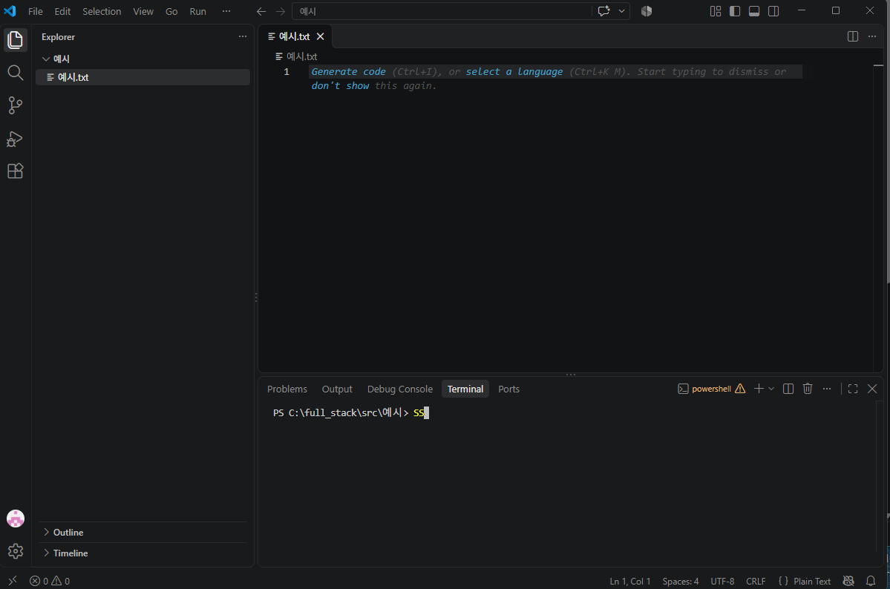
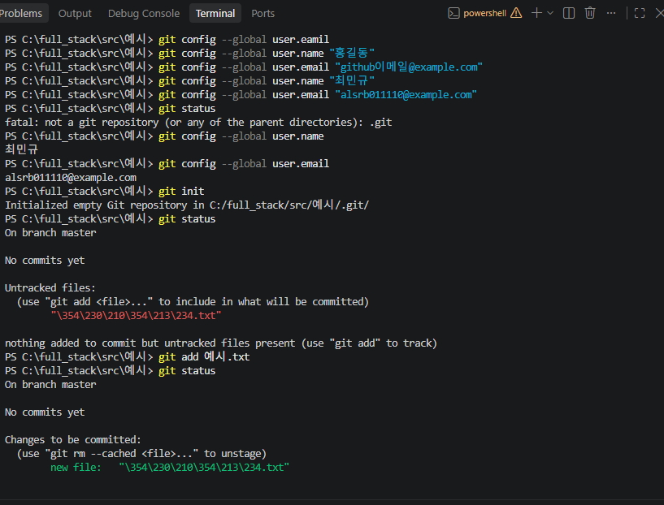

# TIL 2026-10-27 git_push 활용
####  📗
|과정|
|---|

 1 폴더 만들기 + 파일 만들기 VS Code 

2 git init → add → commit VS Code 터미널 (내 컴퓨터 안)

3 GitHub 저장소 만들기 GitHub 웹사이트 (인터넷)

4 저장소 연결 + push VS Code 터미널 → GitHub

5 한 번 더: 수정 → add → commit → push VS Code + 터미널

 👀중간중간 기억하기 👀
```
1. 파일은 저장(Ctrl+S, Mac은 Cmd+S) 해야 git이 알아봅니다. 파일 이름 옆에 ● (흰 점)이 보이면 아직 저장 안 된 거예요.
2. 터미널 명령어는 내 폴더 안에서 쳐야 합니다.
3. 막히면 git status 부터 쳐 보세요.
```
| VS Code에서 폴더와 파일 만들기 |


```
새 폴더 만들기 > VS code에서 그 폴더 열기 > 파일 만들기 > VS Code 안에서 터미널 열기
```
*내 컴퓨터에 기록 남기기


```
git 설치 이름 설정 확인 
> (git  --version)
  (git config --global user.name)
  (git config --global user.eamil)
이폴더를 git저장소 만들기 (폴더당 한 번)
>(git init)
지금 상태 확인하기
>(git status)
파일을 대기실에 올리기
>(git add 예시.txt)
 (git status)
 ```
 | Github에서 저장소 만들기 |

 github.com 접속 → 로그인 → 오른쪽 위의 + 아이콘 → New repository 클릭

| 내 컴퓨터와 github 연결하고 push 하기 |

```
|랜치 이름 main으로 맞추기|
(git branch -M main)
hub 주소 origin으로 등록
(git remote add origin https://github.com/내아이디/git-practice.git)
(git remote -v)
github 올리기
(git push -u origin main)
```
